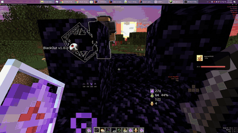
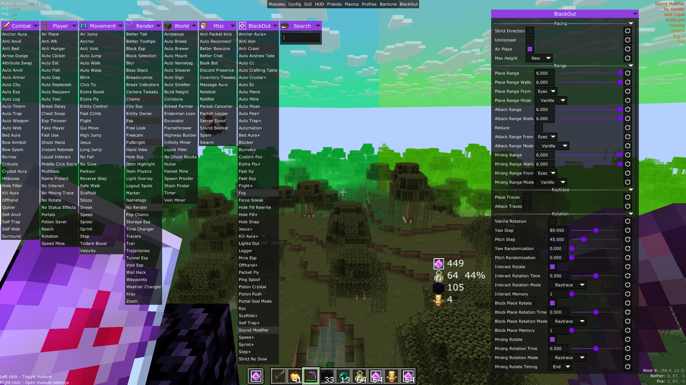

## ... join 'Vicore Development' at https://discord.gg/DTUbmUyCft for some updates about ts

<table>
  <tr>
    <td align="center" valign="middle" width="66%">
      
    </td>
    <td align="center" valign="middle" width="34%">
      
    </td>
  </tr>
</table>

# Blackout
An addon for Meteor client that adds a variety of legacy/improved features to the Meteor client
such as a CrystalAura, BedAura, PacketFly and a lot more of new things to push you above the competition.

### Development

As october of 2026, the original devs seems to be gone 

### How to use Blackout:
 - Install Fabric 1.21.1
 - Download Meteor Client and put it in your mod's folder.
 - Put Blackout in your "mods" folder with Meteor.
 - Run Fabric.
 - Enjoy the addon.
 - Join the discord if you have any issues with it.

#### Credits

Doogie13 for helping with the block mining calculations and step offsets.
RickyTheRaccoon for his InvSwitch.

#### Official youtube channel https://www.youtube.com/channel/UCq_NxTxgS-Xk0TsSmhqXoyg

### Once you go black you never go back

  

